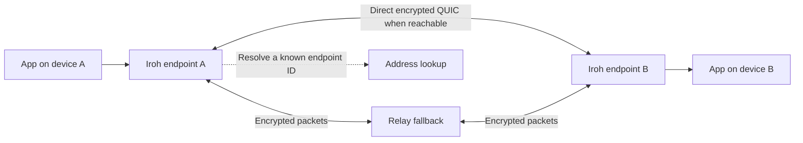

# What Iroh does

Research date: 2026-10-16. This is a synthesis of official documentation and
selected source inspection, not a report of executed network tests.

## The basic idea

Iroh is an embeddable networking library, written in Rust by Number 0. An app
asks to connect to a peer's cryptographic public key instead of managing that
peer's current IP address. Iroh finds addressing information, authenticates the
peer, establishes an encrypted QUIC connection, and manages available paths.

The application decides what to send and who may use it. It can be a file sender,
chat app, shared notebook, device controller, or service with client/server roles.
Iroh does not itself supply a complete product, user accounts, a UI, or a global
file-storage service. Its core is dual-licensed MIT/Apache-2.0.

Sources: [overview](https://docs.iroh.computer/what-is-iroh),
[core repository](https://github.com/n0-computer/iroh/tree/v1.3.0).

## How two devices connect

1. Each endpoint has an Ed25519 keypair. Its public key is its `EndpointId`;
   its secret key proves its identity. Save the secret key if identity must
   survive restarts. Different running endpoints need different identities.
2. The app obtains the other endpoint's ID, for example by scanning a QR code,
   copying a ticket, or consulting the app's own directory. Iroh's address lookup
   resolves an already-known ID; it does not discover which people we want.
3. Address information comes from a ticket, explicit addresses, or configured
   lookup services. The `N0` preset uses Number 0's public relays and DNS/Pkarr
   services. Local mDNS and Mainline DHT lookup are additional opt-in mechanisms.
4. Peers can initially communicate through a relay while trying direct UDP paths.
   NAT traversal coordinates outbound packets to open usable paths through NATs
   and firewalls. Known reachable addresses may allow a direct path immediately.
5. Application traffic uses a direct path when available and can remain relayed
   when direct connectivity is unavailable. Both paths retain end-to-end
   encryption. A usable network path still has to exist; there is no guarantee
   of connecting through every firewall or during total disconnection.

Sources: [endpoints](https://docs.iroh.computer/concepts/endpoints),
[address lookup](https://docs.iroh.computer/concepts/address-lookup),
[relays](https://docs.iroh.computer/concepts/relays),
[NAT traversal](https://docs.iroh.computer/concepts/nat-traversal).

## Building blocks

| Component | Provides | Application still decides |
| --- | --- | --- |
| `iroh` | Authenticated encrypted QUIC connections, reliable streams, datagrams, path management | Message format, framing, permissions, persistence, retries and UX |
| `Router` + ALPN | Dispatch incoming connections to protocol handlers; several protocols can share an endpoint | Protocol selection and compatible wire versions |
| `iroh-blobs` | BLAKE3 content addressing, verified streaming, range retrieval, resumable blob transfer | Which peers hold data, access control, retention, quotas, filesystem policy |
| `iroh-gossip` | Topic-based broadcast through a peer overlay | Bootstrap peers, topic membership policy, history, durable delivery, message authorship |
| `iroh-docs` | Eventually consistent replicated key/value entries; content in blobs, live notifications via gossip | Application data model, author identity, permissions, conflict semantics, availability |
| Automerge over Iroh | Example integration of structured CRDT synchronization with Iroh transport | Product schema and integration; currently described as experimental |
| `irpc` / streaming protocols | Higher-level RPC or media transport options | Service contracts or capture, codecs, playback, media UX |

A blob hash identifies bytes and verifies integrity; it does not automatically
find a provider or ensure that someone will keep serving the content. Iroh address
lookup resolves endpoints, not arbitrary content hashes.

Gossip is useful for live events, but is not a durable message queue or an offline
inbox. A topic needs an initial reachable peer. Do not assume a public relay
provides a topic-membership directory. A topic ID alone is not a complete invitation.

In `iroh-docs`, entries are indexed by namespace, author, and key; content values
are blob hashes plus metadata. Convergence does not automatically produce the
application's intended merge behavior. A shared rich-text editor may require a
different CRDT model, such as Automerge. Document metadata becoming available
is also distinct from the content bytes finishing download.

Sources: [protocols](https://docs.iroh.computer/concepts/protocols),
[blobs](https://docs.iroh.computer/protocols/blobs),
[gossip](https://docs.iroh.computer/connecting/gossip),
[documents](https://docs.iroh.computer/protocols/documents),
[Automerge](https://docs.iroh.computer/protocols/automerge),
[streaming](https://docs.iroh.computer/protocols/streaming).

## Native applications versus browsers

Native Rust provides the fullest integration. Native bindings are available for
JavaScript/Node.js, Python, Swift, Kotlin, Go, and C; check the exact binding and
platform before selecting a stack. A Node process using `@number0/iroh` can use
native direct connections. That npm package is not the browser Wasm build.

Iroh also runs in browser WebAssembly, but **browser traffic currently traverses
relays** because browsers do not expose the UDP sockets needed for its direct
NAT traversal. Encryption remains end to end. The browser documentation suggests
an application-specific Rust wrapper exposed through `wasm-bindgen`; it does not
offer a general official Wasm npm package. Browser support is useful, but changes
bandwidth costs, throughput expectations, and what our experiment can prove.

A desktop app with a web UI and native Iroh backend is another option. In that
architecture the native process is the Iroh endpoint. If a browser talks to a
remote backend, Iroh's transport encryption ends at that backend, not at the
browser; the browser-to-backend connection needs its own protection.

Sources: [Rust](https://docs.iroh.computer/languages/rust),
[JavaScript](https://docs.iroh.computer/languages/javascript),
[browser limitations](https://docs.iroh.computer/languages/wasm-browser),
[platform compatibility](https://docs.iroh.computer/compatibility).

## Security, privacy, and availability boundaries

- TLS/QUIC authenticates the peer key and encrypts traffic. The app must still
  bind that key to a trusted person/device and authorize requested operations.
  Encryption does not imply that every connecting peer should receive files.
- Direct peers learn one another's network addresses. Relays can observe
  connection metadata even though they cannot read the encrypted payload.
  This is not anonymity or encryption of local files at rest.
- Default public lookup publishes signed reachability records. Changing relays
  alone does not replace the public lookup service. Configure both if operating
  private infrastructure.
- Tickets package addresses and possibly application capabilities. They are
  reusable, may include IP addresses, and can become stale. A document write
  ticket is sensitive. An ordinary endpoint ticket is not a one-time password.
- Relays forward traffic; they do not store an offline recipient's messages or
  keep files available after their providers shut down. Offline delivery or
  asynchronous sharing needs application storage and sufficiently available peers.
- LAN operation without the internet is possible with suitable direct addresses
  or local discovery. Public lookup/relay dependencies and startup waits must
  be configured accordingly.

Sources: [security](https://docs.iroh.computer/concepts/security-privacy),
[tickets](https://docs.iroh.computer/concepts/tickets),
[hooks](https://docs.iroh.computer/connecting/endpoint-hooks),
[FAQ](https://docs.iroh.computer/about/faq). Documentation inconsistencies are
recorded in [implementation notes](implementation-notes.md).

## Infrastructure and costs

Public relays are free, shared, rate-limited infrastructure intended for development
and hobby use, with no SLA. They are a reasonable starting point for a small
experiment. Production can use self-hosted relays or paid shared/dedicated
services. Self-hosting also involves deployment, certificates, traffic capacity,
monitoring, and deciding which lookup service to use.

Direct transfer can reduce relay/cloud traffic, but does not remove endpoint
bandwidth or storage costs. A browser-heavy product may relay essentially all
Iroh traffic. The site's roughly 90% direct-connect statement is an upstream
claim about network conditions, not a measured result for our devices; the
homepage's 95% cost illustration is not our budget forecast.

Sources: [public relays](https://docs.iroh.computer/iroh-services/relays/public),
[self-hosting](https://docs.iroh.computer/iroh-services/relays/self-hosted),
[pricing](https://www.iroh.computer/pricing).

## Nearby technologies

| Technology | Main distinction relevant to our decision |
| --- | --- |
| Ordinary HTTP/WebSocket backend | Central service is a natural place for always-available data and coordination; Iroh can add direct device connections alongside it |
| Tailscale | Provides a device-wide network interface; Iroh embeds connectivity into an individual app |
| WebRTC | Offers browser direct connectivity and mature browser media primitives; Iroh currently needs relays in browsers |
| IPFS/content networks | Content addressing and provider discovery are separate concerns; Iroh blobs supply verified content transfer, not a global content-publishing network |

These are scope comparisons, not benchmarks or claims that one choice is always faster.
